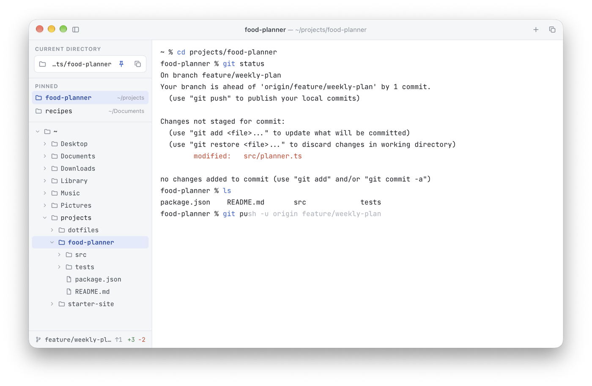

# Hush

A native macOS terminal with an editor-like command line, built with
[GPUI](https://www.gpui.rs) and alacritty_terminal.



## Why

A terminal that stays out of the way:

- **No extras.** No account, no AI, no popups. Your normal zsh with your own config.
- **Native controls.** The command line edits like any macOS text field: click, select,
  ⌘⌫, ⌥←/→, ⌘Z.
- **One surface.** Input isn't a separate box, so you can select across output and the
  command you're typing.
- **Just enough help.** History suggestions, tab completion and a folder sidebar.

## Building

Requires Rust.

```sh
cargo run --release -p hush-gpui   # run it
hush-gpui/bundle.sh                # Hush.app in target/release/bundle
cargo test --workspace             # tests
```

The code is split into `hush-gpui` (the app) and shared crates in `crates/`:
`hush-core` (PTY, shell integration, git, files, Send to Claude), `hush-editor` (the
command line editor) and `hush-complete` (completion and history suggestions).

## Releasing

The version lives in `hush-gpui/Cargo.toml`. To publish a release, set it there,
commit, then tag and push:

```sh
git tag -a v0.2.0 -m v0.2.0
git push --follow-tags
```

The release workflow builds the `.dmg` on GitHub and attaches it to the release.

## How it works

Hush runs your normal zsh. A small integration script
(`crates/hush-core/shell/zsh/hush.zsh`) is loaded after your own startup files and
marks prompts with OSC 133 escape sequences. While zsh waits at a prompt, Hush handles the keyboard itself and draws the
command into the terminal grid. On Enter it writes the command to a per-session file
and sends a private key sequence; a ZLE widget loads it into `BUFFER` and runs it.
While a command runs, input goes straight to it, so vim, htop and ssh behave as usual.

Other shells work too, without the editor features.

## Notes

- Send to Claude needs the Accessibility permission. It looks for the message box in
  the Claude app and only pastes when it's sure; otherwise the text is just copied.
  `cargo test -p hush-core claude_dry_run -- --ignored --nocapture` checks this
  against a running Claude app without changing anything.
- Keys typed before the next prompt appears go to zsh, not to Hush's editor.
- The folder tree only shows local folders.
